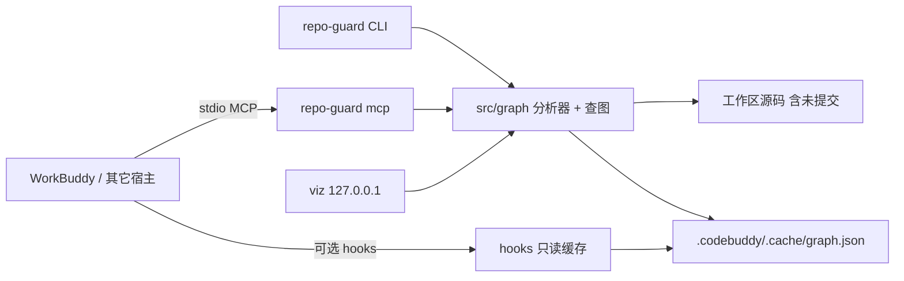
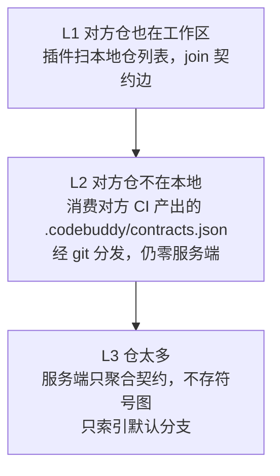

# WorkBuddy 代码图谱（多仓）技术方案

> 状态：单仓查询与 MCP **已落地**；工作区多仓路由与跨仓契约索引 **设计已定、实现待排**（P6）。
> 对照实现：[`GRAPH.md`](GRAPH.md)、[`MULTI-REPO.md`](MULTI-REPO.md)、[`GRAPH-VIZ.md`](GRAPH-VIZ.md)。

---

## 0. 为什么要写这份

WorkBuddy 要让模型在改代码前看见结构，而不是只靠 grep。一种现成做法是接入第三方代码图谱 MCP，例如开源 **CodeGraph**（npm：`@colbymchenry/codegraph`）：

- 本地用 **tree-sitter** 解析代码
- 把符号、调用边、文件结构存进 **SQLite**（带 FTS5 全文检索）
- 经 **MCP** 提供查询：符号定义、调用方、被调用方、影响范围

这条路的形状是对的：**图谱必须是本地 MCP，不能做成远端黑盒。** 但 CodeGraph 回答的是「这个符号在哪、谁引用了它」；我们要回答的是「改这个会波及哪些页面/接口、仓里同类怎么写、这个入口实际打到哪、对方服务有没有在调我」。

后者是框架语义和契约，不是 CST 上的引用闭包。本文给出 **WorkBuddy 应接入哪套图谱、多仓怎么建、和 CodeGraph 如何分工**。

命名易混：本仓库内部类型也叫 `CodeGraph`（`src/graph/types.ts`）。下文 **CodeGraph** 专指开源 npm 包，本方案称 **repo-guard 图谱**。

---

## 1. 目标与非目标

### 1.1 目标

| 对象 | 要能做到 |
|---|---|
| 人手上正在改的仓 | 含未提交改动的符号级图；改公共层前能查影响面 |
| WorkBuddy 里的模型 | 经 MCP 拉到带盲区、带入口分数的报告，而不是邻接表 |
| 人 / reviewer | CLI 与本地 viz，不依赖对话 |
| 多微服务 | 跨仓只接契约边：谁提供 `POST /order/create`、谁在调 |
| 公司接入 | 同一条零依赖二进制；可只开图谱、不开写前守卫 |

### 1.2 非目标

- **不把 CodeGraph 当影响面权威源。** 它适合符号检索，不承担路由级 impact / similar / 契约。
- **不做跨仓符号级图谱合并。** 微服务不共享符号，合并方法图会给出假答案。
- **不建公司级图谱平台 / 常驻索引服务。** 服务端拿不到未提交改动；给旧影响面比不给更坏。
- **不把 `graph.json` 进 git。** 图是代码投影，删了重跑一样。跨仓进 git 的是契约，不是图。
- **不在 hook 里建图。** 写前只有十几秒预算；缓存 miss 放行。
- **现在不另开图谱仓。** 引擎与 MCP 查询语义必须锁步；外置后 plugin 只留 adapter，那是以后的事。

---

## 2. 和 CodeGraph 怎么选

两种 MCP 都是「本地解析 + 给模型查」，但问的不是同一个问题。

| | CodeGraph（`@colbymchenry/codegraph`） | repo-guard 图谱 |
|---|---|---|
| 解析 | tree-sitter CST，语言面宽 | 按「语言 × 框架」选最强解析器（Babel / go ast / javaparser / Python `ast`） |
| 存储 | SQLite + FTS5 | `<repo>/.codebuddy/.cache/{graph,meta}.json` |
| 查询 | 定义 / 引用 / 调用方 / 被调用方 / 文本检索 | `impact` `similar` `hot` `lib_search` `trace` `contracts` `scan` |
| 影响面 | 符号引用闭包 | 反向最多 3 跳，落到**用户可见入口**（页面 / HTTP），带边权 |
| 框架语义 | 弱（看不到 Gin / Spring / tRPC / 页面指纹） | 分析器产出 `RouteNode`、`@api` 边、页面指纹、方法家族 |
| 盲区 | 无一流数据 | 分析器自述 `blindSpots`，每次查询附带 |
| 空图 | 容易被读成「没有引用」 | 置信度不够则明确失败，禁止空图 |
| 未提交改动 | 取决于是否重索引 | HEAD + 源文件最大 mtime，专管「改了还没提交」 |
| 多仓 | 多根目录灌进同一套 SQLite（合并图） | 本仓实时图 + 跨仓契约索引，不合并符号 |
| 分发 | 原生 tree-sitter 语法包 | 单文件零依赖 CJS，内网可装 |
| 守卫 | 无 | 可选：公共层未查 impact 则 deny |

Python 分析器已经写过为什么不用 tree-sitter：它给的是 CST，函数嵌套、装饰器、方法归属要自己推；标准库 `ast` 零依赖且带 scope。这是「每种语言用它自己最强的解析器」，不是解析器竞赛。

**结论（接入策略）：**

1. **WorkBuddy 的主图谱 MCP = repo-guard。** 影响面、同类、调用链、契约、体量体检走这一条。
2. **CodeGraph 可作辅路，不可并列成第二套 impact。** 若需要「跨小语种跳定义 / FTS 搜标识符」，单独挂、工具名避开 `impact` / `trace`，并在说明里写清：引用列表不是回归清单。
3. **禁止两个「影响范围」工具同时出现。** 模型会随便挑一个；CST 引用闭包会把 dto 弱引用打成「波及 90 个接口」。

---

## 3. 当前能力（单仓，已落地）

### 3.1 一句话

动手前用 MCP / CLI **拉**一张从本仓代码现算的图。过程门禁可以要求「本轮查过」；hook **禁止建图**，缓存 miss 就放行。

### 3.2 架构



三个入口共用一个二进制，因为它们必须共享图谱缓存和「本轮查过没」的会话状态。

| 入口 | 建图？ | 用途 |
|---|---|---|
| MCP | 是 | 模型主路 |
| CLI | 是 | 人 / CI |
| `viz --serve` | 是，但 `sideEffects:false` | 人在图上模拟；**不替 AI 放行守卫** |
| PreToolUse hook | **否**，只读缓存 | 公共层未查 impact → deny |

### 3.3 MCP 工具（图谱 7 + 守卫 2）

图谱查询：

| 工具 | 何时 | 返回 |
|---|---|---|
| `impact` | 改**已有**文件前 | 直接调用者、依赖、受影响入口（带分数）、盲区。支持 `file#symbol` / `Agent.ID` |
| `similar` | 写新页 / 新接口前 | 前端：页面指纹骨架。后端：方法家族 + 按动作核对 + 分层骨架 |
| `hot` | 写新公共方法 / 组件前 | 带 intent 按名字与注释找现成方法；否则全仓高扇入 |
| `lib_search` | 写新 UI 组件前 | 本仓组件库有没有现成的 |
| `trace` | 这个页面 / 接口打到哪 | 入口 → handler → 下游；前端可反推出入参 |
| `contracts` | 从调用点生成类型草稿 | **必须人 review**，不能当已有类型 |
| `scan` | 体量体检，可挂 CI | 超长文件、循环依赖；有问题非零退出 |

`check` / `audit` 挂在同一 MCP 上，分别是守卫自查和红线体检，不是图谱查询。WorkBuddy 若只接图谱，可只暴露上表 7 个。

工具描述本身承担教学，例如：

- `impact`：「影响面为 0 不等于可以删」
- `lib_search`：「内部组件库不在训练数据里，凭 antd 经验写的 props 几乎一定是错的」

这是 CodeGraph 这类通用符号 MCP 不会带的部分，也是不能只把分析器拆成 SDK 丢掉的原因。

### 3.4 影响面怎么算

```
① 直接调用者
② 沿反向依赖最多 3 跳
③ 落到入口：handler 文件在传播集里，或 handler 函数直接调了目标
```

`分数 = 上一跳 × 边权 × 0.6`，多路径取最强。`≥ 0.5` 为强影响。

| 边 | 权 | 含义 |
|---|---|---|
| 函数调用 / JSX | 1.0 | 真用了 |
| 继承 | 0.9 | |
| 调后端接口 | 0.6 | |
| 模块 import | 0.5 | import 了不代表真用了 |

入口 ≥ 5：只允许新增可选参数，不要改已有签名。

### 3.5 读图纪律（必须随 MCP 一起交给模型）

- **影响面为 0 ≠ 可以删。** 只说明图能看见的范围内没有调用者。
- 每次查询带 **盲区**：动态 import、运行时拼路径、样式、SQL、离线任务、跨服务。
- **空图必须失败显式化。** 所有分析器低于阈值 → 「暂不支持这个技术栈」，禁止假装没人用。
- 「未查到」不得写成「不存在」。
- 跨仓 join **只允许严格匹配** URL/方法，禁止末段模糊命中。

### 3.6 缓存

落在 `<repo>/.codebuddy/.cache/`，不进 git。失效判据：

1. git HEAD 变了（切分支、拉代码）
2. 源文件最大 mtime 变了（**改了还没提交**）
3. 文件数变了

第 2 条是本地图相对任何「按 commit 入库」方案的不可替代点。AI 刚改完，给旧影响面比不给更坏。

分析器：前端 React/Vue、Node/TS、Go Gin/tRPC、Java Spring、Python。探测置信度都不够时显式失败。

### 3.7 协作开发：别人提交了，要不要实时更新

**不要。** 图谱没有「分支」这个维度，只有工作区的一个「现在」。别人的提交只要还没出现在你磁盘上的源文件里，就不该进你的图。

这和 §4.3「未提交改动是分水岭」是同一条纪律：图必须等于你正在改的代码。把远程分支上你没拉下来的 commit 画进来，等于拿一份你跑不了、也 review 不到的代码做影响面——比不更新更坏。

| 同事做了什么 | 你本地发生了什么 | 图谱 |
|---|---|---|
| 推到远程，你没 fetch / 没 pull | 工作区与 HEAD 都没变 | **不更新**（正确：那些文件不在你磁盘上） |
| `git fetch`，尚未 merge / rebase | `origin/*` 变了，HEAD 与工作区没变 | **不更新**（正确：你还在旧树上改） |
| `git pull` / merge / rebase 合入 | HEAD sha 变了，源文件 mtime / 数量通常也变 | **下次 MCP/CLI 查询时自动重建** |
| 切分支 | HEAD 变 | 同上，下次查询重建 |
| 你自己改了还没提交 | HEAD 不变，mtime / 文件数变 | 下次查询重建 |
| 两人在不同 feature 分支 | 两套工作区，两张「现在」 | 各看各的；合入对方之后才出现在你的图里 |

触发方式是 **懒重建**，不是文件监视、不是听 `git push`、也不是后台按分支预建：

1. 每次 `impact` / `similar` / `trace` / `viz` 前先比 `HEAD + max mtime + fileCount`
2.  stale 就现算并覆盖 `graph.json`
3. hook **仍然不建图**。你刚 pull 完立刻写公共层、还没查过 impact：缓存已过期 → fail-open，门禁当没这道图谱强制（公共层「没查过」仍会拦）

所以「实时」的边界是：**你一查，就对你此刻工作区实时；不是对 origin 实时。**

多人同需求时的正确用法：

1. 先 `git pull --rebase`（或 merge）把同事的提交接到工作区
2. 再调 `impact`（或任何会 `getGraph` 的 MCP/CLI）——这一下会因 HEAD 变化重建
3. 不要指望「同事一 push，我这边的图自己变」

可选增强（未做，且不做预建多分支索引）：查询报告里若发现当前分支落后 `origin/<branch>` N 个 commit，加一句「本地图不含未拉取的 N 个提交，影响面可能漏报同事刚合入的调用方」。这是**提醒去 pull**，不是从远程偷文件来建图。

明确不做：

- 不为每个活跃分支各留一张图（feature 分支生命周期短，建完就废）
- 不在 `git fetch` 时预热
- 不监听远程仓库 webhook
- 不把「落后 origin」当成缓存失效——失效只看工作区

平台侧按 `(repo, commit)` 入库才会碰到「为谁建图」的爆炸（默认分支 / 全部分支 / 按需）。本地插件把分支维度塌成 1：只有工作区这一个 commit + 未提交改动。

---

## 4. 多仓方案（设计）

现状是**隐式单仓**：仓库根从 cwd 推出，全程一个值。deerclaw 能多仓，是因为服务端把 N 个仓的图建好放在一起。本方案没有服务端，也不照搬那条路。

### 4.1 三种「多仓」，处理完全不同

| 形态 | 现在 | 方案 |
|---|---|---|
| **monorepo**（一仓多包） | `findRepoRoot` 可能在子包 `package.json` 停住，图被截断，impact **少报** | 先全层找 `.git`，找不到再退其它锚点 |
| **多根工作区**（父目录挂 repo-a / repo-b） | 可能静默当成一个大仓：两仓文件混图，各仓红线都不读 | `discoverRepos` 扫一层 `.git`；`session-start` 必须明说「检测到多仓，当前只守 X」 |
| **跨仓影响面**（改 A 的接口，炸 B 的调用方） | 做不到 | **契约索引，不是合并图谱** |

少报影响面是最坏方向：模型会把「没有调用者」当事实去删。

### 4.2 关键语义反转：仓由文件决定，不由 cwd 决定

现在：`repoOf(cwd)` → 一个仓 → 判所有文件。

多仓：`resolveRepoFor(filePath)` → 文件属于哪个仓 → 用**那个仓**的配置与图。

| 位置 | 多仓下 |
|---|---|
| `discoverRepos(workspaceDir)` | 扫一层子目录找 `.git`，返回仓列表 |
| `resolveRepoFor(repos, filePath)` | 最长前缀匹配 |
| hook 写类事件 | 先定仓再判；一次事件多仓则按仓分组 |
| `getGraph(repoDir)` | 不变；调用方**只给本次涉及的仓建图**。禁止 N 仓一起建 |
| 配置 | 工作区 `<workspace>/.codebuddy/` 共享层，各仓覆盖 |
| 会话状态 | 已按 `repoId` 隔离（G3 用例钉住），不用再改 |

建图成本：每仓一次全量，万文件级可达几十秒。所以 hook 只读缓存；MCP/CLI 按涉及仓现算。

### 4.3 本地图 vs 对端索引：分工，不是二选一

分水岭是 **未提交改动**。按 commit 建的 SQLite / 平台索引，结构性拿不到工作区脏文件。

| | 手上正在改的仓 | 被影响的对方仓 |
|---|---|---|
| 需要什么 | 符号级图 + 工作区当前状态 | 只需要「这个 handler 谁在调」 |
| 分支 | 只有一个「现在」 | 默认分支 / 已部署 commit |
| 代码要在本地吗 | 必须有 | 不必 |
| 结论 | **本地实时图，不可替代** | 预建契约索引完全够 |

这同时否定两件事：用 CodeGraph 一套 SQLite 灌进所有微服务当主图；以及自建「全公司方法图服务」。

### 4.4 跨仓边是契约边

后端微服务不共享符号，耦合在 HTTP / RPC / MQ topic 上。跨仓不需要合并方法图，只需要：

> 谁提供 `POST /order/create`，谁在调它。

数据量差两三个数量级：每仓几百条路由，不是几万个符号。小到可以进 git。

两端已经在说同一种语言：

| 侧 | 现有产出 | 出处 |
|---|---|---|
| provider | `RouteNode { method, urlPath, handlerFile, handlerFn }` | Go / Java / Python 分析器 |
| consumer（前端） | `calls[]` 中 `toObj='@api'`，`toMethod='POST /console/xxx'` | `web-frontend` |
| consumer 字段 | `ApiContract { api, request[], response[] }` | `frontend-contracts` |

Join key：consumer 的 `toMethod` 与 provider 的 `method + urlPath`。**只允许严格匹配。**

**缺的第一块（跨仓必做项）：后端→后端出向 `@api`。** Go / Java / Python 分析器现在不产出「这个服务调了别的服务哪个接口」。没有它，微服务之间接不上。这不是合并图那种大工程。

可视化同一口径：跨仓时中心换成多个服务名，边只在 API / `pkg` 对齐处连；没有对面 cache，不得画假图。

### 4.5 三级落地（渐进，不互斥）



| 级 | 场景 | 依赖 | 破零服务端？ |
|---|---|---|---|
| 1 | 2–5 个仓同工作区 | `discoverRepos` + 出向 `@api` | 否 |
| 2 | 对方未 clone（性价比最高） | 各仓 CI 写 `contracts.json` | 否 |
| 3 | 仓数爆炸 | 契约聚合服务 | 仅契约，不存图 |

L2 与红线同一纪律：意图/契约跟代码走 PR，能 review、能回溯。

`contracts.json` 建议形状（实现时再钉 schema，此处给语义）：

```jsonc
{
  "version": 1,
  "repo": "order-service",
  "commit": "abc1234",
  "provides": [
    { "method": "POST", "urlPath": "/order/create", "handler": "CreateOrder" }
  ],
  "consumes": [
    { "method": "POST", "urlPath": "/user/describe", "from": "CreateOrder" }
  ]
}
```

只含路由契约，不含函数列表、不含未提交符号。WorkBuddy 跨仓 impact 先查本仓图，再 join 这些记录。

---

## 5. WorkBuddy 怎么接

和接 CodeGraph 同一槽位：**MCP stdio**。不要为图谱再开 HTTP 服务。

### 5.1 两个 profile，一个二进制

| profile | 装什么 | 给谁 |
|---|---|---|
| **graph** | MCP + CLI + viz + skill | 先只要查询 |
| **guard** | 上面 + hooks（写前 impact 等） | 愿意被拦的团队 |

WorkBuddy 侧 MCP 配置与 CodeBuddy 相同：

```json
{
  "mcpServers": {
    "repo-guard": {
      "command": "node",
      "args": ["<plugin-root>/bin/repo-guard", "mcp"]
    }
  }
}
```

graph profile **不注册 hooks**。没有写前守卫，图谱仍然有用；有守卫，才是完整件。不要把门禁当接入前提。

若同时试验 CodeGraph：

- 工具前缀必须不同（`codegraph_*` vs `impact` / `trace`）
- 系统提示写明：改公共层、问回归入口，只许调 `repo-guard` 的 `impact`
- 不要把 CodeGraph 的 references 当成「受影响页面清单」

### 5.2 会话与仓

- 查询「查过」记在 `$HOME/.repo-guard/`，key 带 `repoId`，避免 A 仓查过放行 B 仓同名文件
- 宿主若不传会话 id，按仓认领当前会话（12 小时过期），避免「查了 impact 仍被拦」
- viz 沙盘走同一 `callTool`，但禁止写会话状态：人点一下不能替模型放行

### 5.3 人怎么看

| 形态 | 命令 |
|---|---|
| 静态体检页 | `repo-guard viz` → `.codebuddy/.cache/viz/` |
| 本地沙盘 | `repo-guard viz --serve` 只绑 `127.0.0.1` |
| 斜杠命令 | `/repo-guard:graph`、`/repo-guard:impact` |

跨仓视图是下期：先有契约边，再画多服务中心图。

---

## 6. 分期

| 阶段 | 内容 | 状态 |
|---|---|---|
| P0 | 单仓建图 + MCP/CLI 七查询 + 缓存 + 读图纪律 | 已落地 |
| P0b | 本地 viz / 沙盘；impact 符号级；后端 similar 方法家族 | 已落地 |
| P1 | WorkBuddy graph profile：只挂 MCP，文档与工具白名单 | 待做（配置，无引擎改动） |
| P2 | `findRepoRoot` 优先 `.git`；多根工作区显式警告 | 待做（与跨仓无关，monorepo 现在就该修） |
| P3 | 后端出向 `@api` | 跨仓第一块必做 |
| P4 | `discoverRepos` + `resolveRepoFor`；按文件定仓 | 工作区 2–5 仓 |
| P5 | CI 产 `contracts.json`；本仓图 join 对端契约（L2） | 对方不必 clone |
| P6 | 仓太多时契约聚合（只存契约） | 按需，不默认 |

不把「先上 CodeGraph 再替换」列为阶段。主查询面一旦被 CST 影响面占用，模型习惯和门禁文案都要再扳回来。

---

## 7. 风险与纪律

| 风险 | 处理 |
|---|---|
| 空图 / 少报被当成可删 | 阈值失败显式化；盲区强制输出；少报视为事故 |
| 两个 impact 工具并存 | WorkBuddy 白名单只留 repo-guard 图谱查询 |
| hook 超时建图 | 禁止；miss fail-open |
| 打分漂移 | 不重写 `src/graph` 打分；parity 钉住 |
| 子包截断 / 多根混图 | P2 修锚点 + 显式警告，禁止沉默 |
| 跨仓模糊匹配 | 只严格匹配 method+path |
| 原生依赖进内网 | 主路径保持单文件零依赖；不把 tree-sitter 做成必装 |
| 把 graph.json 当公司资产 | 禁止进 git；共享面是 contracts.json |

---

## 8. 验收

**单仓（现已具备，WorkBuddy 接入时回归）：**

1. MCP `tools/list` 可见 impact / similar / hot / trace / contracts / scan
2. 改公共层未查 impact，guard profile 下写工具被 deny，并指向该调的工具
3. graph profile 无 hooks，查询仍可用
4. 影响面为 0 的回复含盲区，且不出现「可以安全删除」
5. 分析器全低置信度 → 明确暂不支持，不给空图
6. 刚改未提交的文件，mtime 触发重建，impact 看到新符号
7. viz 沙盘与 MCP 同一 `callTool` 文本一致，且不写会话状态

**多仓（P3–P5 完成后）：**

1. 工作区两个 `.git` 时，启动说明当前守哪个仓，不混成一张图
2. 改 A 仓文件只用 A 的配置与缓存
3. A 仓 handler 能 join 到 B 仓（本地或 `contracts.json`）的严格路径匹配调用方
4. 同名末段 `/users` 不得命中另一仓无关路由
5. 没有 B 仓 cache / 契约时，跨仓边显示「未知」，不画假节点

---

## 9. 建议（给 WorkBuddy 决策）

1. **主图谱 MCP 用 repo-guard，不要用 CodeGraph 替换。** 接入方式和第三方 MCP 相同，换的是查询语义。
2. **先开 graph profile，门禁后装。** 公司采用的第一面是「能查」，不是「被拦」。
3. **跨仓做契约索引，不要做公司方法大图。** 本地实时图守正在改的仓；`contracts.json` 守对端。
4. **CodeGraph 若要试验，只作符号/全文辅路**，工具名隔离，禁止进入影响面决策。
5. **引擎暂不拆仓。** 对外契约是 MCP/CLI 工具与 `contracts.json` schema，不是 `src/graph` npm 包。
